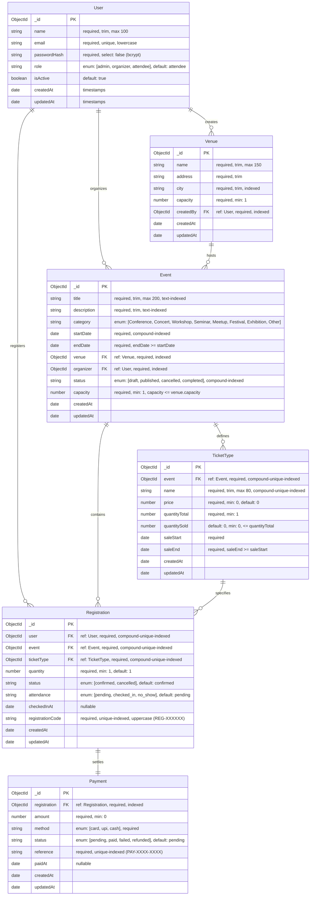

# Entity-Relationship (ER) Diagram: Event Management System (Project 9)

## Conceptual Architecture

The data architecture enforces strict relational referential integrity across 6 core entities:
- **User:** Principal entity representing system actors (`admin`, `organizer`, `attendee`).
- **Venue:** Physical facilities created by organizers/admins hosting events.
- **Event:** Central programme entity, organized by users at venues.
- **TicketType:** Multi-tier inventory allocations defined per event with atomic decrement semantics.
- **Registration:** Formal booking between an attendee, an event, and a ticket tier with unique human-readable code.
- **Payment:** Simulated settlement record directly referencing registrations.

## Key Relational Constraints & Indexes
1. **User:** Unique index on `email`.
2. **Venue:** Single index on `city`, compound index on `{ city: 1, name: 1 }`.
3. **Event:** Full-text index on `{ title: 'text', description: 'text' }`; compound index on `{ status: 1, startDate: 1 }`.
4. **TicketType:** Compound unique index on `{ event: 1, name: 1 }` preventing duplicate tier naming within the same production.
5. **Registration:** Compound unique index on `{ user: 1, event: 1, ticketType: 1 }` preventing duplicate active bookings; unique index on `registrationCode`.
6. **Payment:** Unique index on transaction `reference`.

